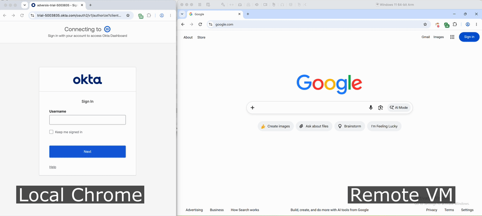

# YubiKey Bridge

Sign in here. Tap your YubiKey there.

Keep your development browser on one computer and your YubiKey on another. Open GitLab locally, start sign-in, and tap the key remotely and the origin-bound authorized response returns to your original login tab. Use responsibly.

Two Chromium extensions connect through a dumb encrypted Cloudflare relay. No native helper, SSH tunnel, or USB forwarding needed.

- **Local:** browse, manage profiles, and choose authenticator preferences
- **Remote:** approve the browser’s authentication prompt

[How it works](docs/tech-details.md)

## Setup

1. Deploy the Cloudflare Worker relay 
   1. From `relay/`, run `npx wrangler login`, then `npx wrangler deploy`. Verify `https://YOUR-WORKER.workers.dev/health` returns `ok`. 
2. Load the extensions
   1. At `chrome://extensions`, enable Developer mode and load unpacked `local-extension/` in the login browser and `remote-extension/` on the YubiKey computer. 
   2. Approve remote’s required access to all HTTPS sites
3. Pair
   1. Open local Setup in a tab, enter `wss://YOUR-WORKER.workers.dev/`, then Generate pairing secret -> Copy secret. 
   2. Enter the same URL and secret remotely, and Connect. Verify green indicators.
4. Add a profile locally
   1. In Manage profiles, enter the provider and sign-in URL, such as `https://gitlab.com/users/sign_in`. 
5. Run Preflight
   1. Expect `ok: true` which opens and checks the sign-in page and origin locally. Chrome may request local site permission.
6. Sign in locally; tap remotely
   1. Start the website’s passkey login, complete the remote native ceremony

## Permissions

Remote requires `host_permissions: ["https://*/*"]` at install. Approve Chrome’s read and change data permission. Local uses `scripting` and optional HTTPS access for relay health and local page preflight.

## Limits

This tool does not enforce caller origin metadata in proxied options, and it does not independently establish who controls the paired endpoint. Caveat emptor.

Sign-in only. Credential enrollment is unsupported.

## Troubleshooting

| Signal | Meaning / next step |
| --- | --- |
| Green icon | Relay health, WSS connection, peer presence, and recent encrypted ping verified. |
| Yellow icon | Health or peer connection is not fully verified. |
| Red icon | Relay `/health` check failed. |
| `webauthn-get-rejected` | Remote browser rejected the credential request; inspect its native prompt and error. |
| `assertion-validated` / `assertion-complete` | Assertion checked and returned |

Open Inspect on both sides, use Key events, and filter by RP hostname or the request ID.
