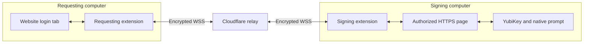
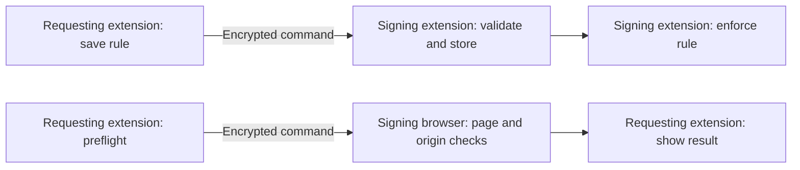

# WebAuthn bridge technical reference

The requesting browser starts the website login and receives its session. The signing browser runs WebAuthn with the enrolled authenticator. The relay carries encrypted messages between their extensions.

| Functional role | Existing extension and protocol name |
| --- | --- |
| Requesting browser | `local-extension/`, `role=local` |
| Signing browser | `remote-extension/`, `role=remote` |

## Components



## Profile management

Profiles are edited in the requesting extension and stored and enforced by the signing extension. The current UI labels the requesting side **local** and the signing side **remote**. Related origins require explicit configuration and the RP’s `/.well-known/webauthn` authorization.




## Caller-origin metadata and this implementation

Current Chromium source adds `remoteDesktopClientOverride` to a request before sending it through the WebAuthn proxy. The override includes the caller origin and whether it shares an origin with its ancestors. The JSON conversion serializes `origin` and `sameOriginWithAncestors`. See the [proxy forwarding code](https://chromium.googlesource.com/chromium/src.git/+/lkgr/content/browser/webauth/authenticator_common_impl.cc) and [JSON conversion](https://github.com/chromium/chromium/blob/main/components/webauthn/json/value_conversions.cc).

In this bridge, the requesting extension parses `requestDetailsJson` and forwards the options. The signing page parses them with `PublicKeyCredential.parseRequestOptionsFromJSON()`. There is no explicit bridge check that compares `remoteDesktopClientOverride.origin` or `sameOriginWithAncestors` with the configured profile. A request capture from the tested browser build is still needed to establish which fields it supplied and how that build parsed and applied them.

The signing code separately checks the HTTPS page origin and validates the returned `clientDataJSON.origin` against the selected profile; it rejects returned `crossOrigin: true`. These checks constrain accepted responses. They do not establish ownership or management of the paired requesting endpoint.

The page-based execution path should not be described as a universal prohibition on origin overrides. Chromium has separately authorized remote-desktop mechanisms for overriding client-data fields; the [remote-client-data explainer](https://github.com/MicrosoftEdge/MSEdgeExplainers/blob/main/WebAuthnRemoteClientDataJSON/explainer.md) distinguishes those mechanisms. This project does not configure their allowlists.

## Request and assertion data

The authenticator signs `authenticatorData || SHA-256(clientDataJSON)` with the credential’s private key. The bridge transports the result. The RP already holds the public key from enrollment and verifies the signature.

| Request field | Handling |
| --- | --- |
| `challenge` | Base64url challenge; checked against returned client data. |
| `rpId` | Required and matched exactly to a saved rule; never inferred from the active tab. |
| `allowCredentials`, including transports | Preserved; cannot be replaced to force another credential. |
| `userVerification` | Preserved; returned UV flag checked when required. |
| `timeout` | Forwarded alongside the bridge’s own deadlines. |
| `hints` | Requesting-browser chooser preference may be prepended; remains a UI hint. |
| `extensions` | Forwarded for browser processing, including legacy `appid` when present. |

Conditional mediation and credential creation are unsupported. The encrypted `get` message adds a bridge UUID, authenticator preference, optional saved-rule ID, and unverified foreground-tab origin. The UUID maps back to Chrome’s original request ID; these extra fields do not attest caller identity.

The returned credential includes `id`, `rawId`, `type`, `response.clientDataJSON`, `response.authenticatorData`, `response.signature`, optional `response.userHandle`, and client extension results. The signing extension checks `webauthn.get`, the exact challenge and signing origin, rejects unexpected cross-origin client data, and checks user presence and required user verification. Normally the first 32 authenticator-data bytes must equal `SHA-256(rpId)`. Only when the browser reports `clientExtensionResults.appid === true` does validation instead require `SHA-256(exact requested AppID URL)`. Requesting AppID alone does not establish its use.

## Browser execution and scheduling

The signing extension opens an active tab at the saved launch URL and waits for the signing origin before injecting the ceremony. A service worker is not a website document, and an extension page has a `chrome-extension://` origin that the RP may reject.

Profiles may group multiple launch URLs and rules under one provider. A redirect never silently authorizes another signing origin: a separately saved rule for that RP/origin must permit it. Related-origin prechecks fetch `https://<RP>/.well-known/webauthn`, require JSON containing the exact signing origin, and complement the browser’s own checks.
The signing extension serializes ceremonies, permits up to four pending requests, and waits briefly between operations. The requesting extension limits repeated RP challenges to guard against retry loops. Cancellation and disconnects clear pending work.

Platform-capability queries are forwarded to the signing browser, where `PublicKeyCredential.isUserVerifyingPlatformAuthenticatorAvailable()` is measured. This reports browser capability, not enrollment of an account’s credential. Browser contention can still cause errors such as `OperationError: A request is already pending`, including after a successful related-origin check.

## Wire format

Both peers store the shared secret in their extension’s `chrome.storage.local`. Derivation and framing are identical on both sides:

| Value | Derivation |
| --- | --- |
| Room ID | 43-character base64url value; complete derivation below. |
| Encryption key | HKDF-SHA-256 → AES-256-GCM; salt `ykwss-v1-salt`, info `encryption`. |
| Nonce | Fresh random 12-byte value per packet. |
| Authenticated associated data | Room ID. |
| Connection | `wss://HOST/ws/<room>?role=local` or `role=remote`. |

The room identifier uses the raw 32-byte secret, with byte concatenation shown as `||`:

```text
room = base64url(SHA-256(UTF8("ykwss-room-v1:") || secret_bytes))
```

```json
{"type":"packet","iv":"<base64url nonce>","ciphertext":"<base64url AES-GCM output>"}
```

Encrypted message kinds include `get`, `result`, `cancel`, `uvpaa-query`, `uvpaa-result`, `profile-inventory`, `manage-request`, `manage-result`, `diag-ping`, and `diag-pong`. The signing extension accepts only an explicit set of profile/preflight management commands over that channel.

The relay uses a Durable Object per room and permits one live socket per role. It forwards ciphertext without the pairing secret. Room IDs, roles, lengths, timing, peer-state messages, and transport `ping`/`pong` remain visible. The room URL is not independent server-side authentication: someone who learns a room ID can attempt to occupy a role or disrupt availability without decrypting messages.

## Relay endpoints and diagnostics

These responses describe the Worker source; deployment-specific edge rules may differ.

| Request | Status / body |
| --- | --- |
| `/health` | `200` / `ok`. |
| `/` or an unmatched path, including invalid room syntax | `404` / `Not found`. |
| Valid `/ws/<room>` with invalid role | `400` / `Invalid role`. |
| Valid room and role without WebSocket upgrade | `426` / `WebSocket required`. |
| Valid upgrade, free role | `101`; WebSocket starts. |
| Valid upgrade, occupied live role | `409` / `Role already connected`. |

An upgraded socket receives `{"type":"peer","online":false}` or `true`; changes are announced as peers connect or disconnect. Plaintext `ping` receives `pong`. There is no HTTP endpoint for room enumeration, assertions, session history, or login results.

Green requires healthy `/health`, a connected socket, an online peer, and a recent encrypted round trip. Yellow means incomplete/unknown readiness; red means failed relay health. None proves authenticator availability or server acceptance. Logs correlate stages using a UUID and a short challenge fingerprint, and can include identifying provider names, origins, and errors. Inspect reports before sharing.

